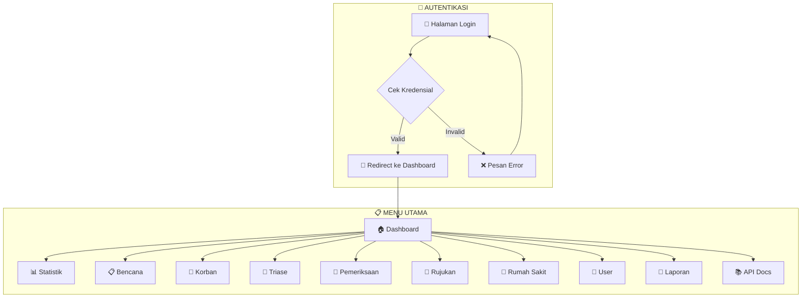
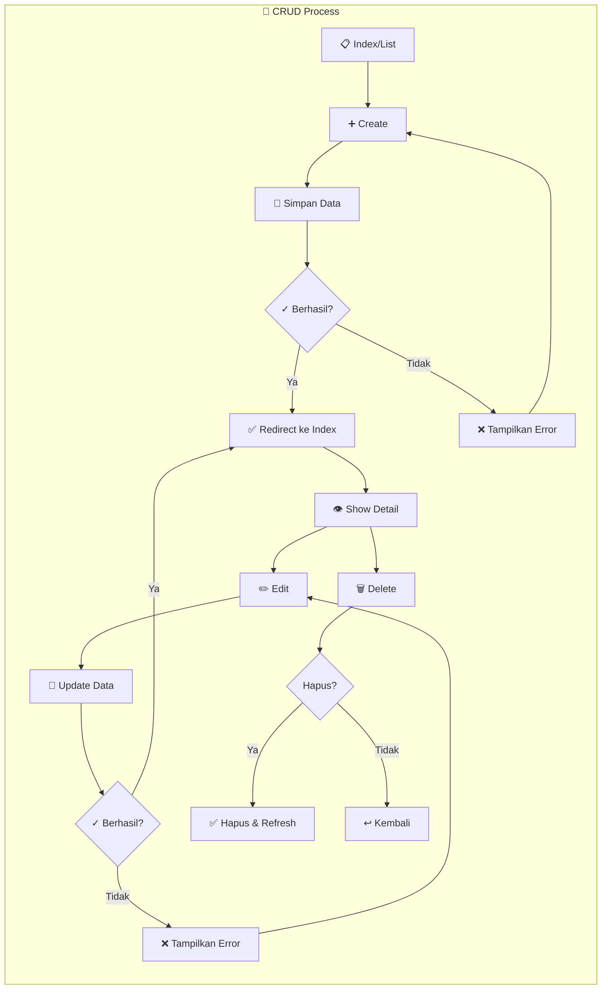
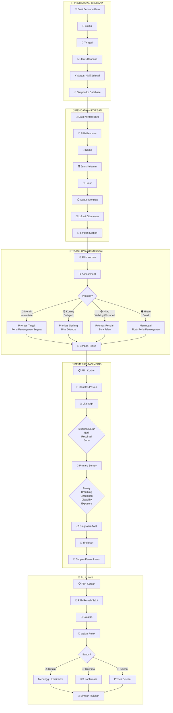
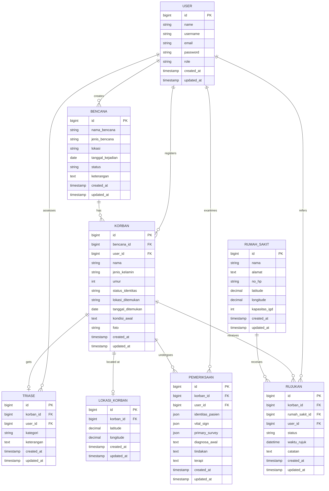
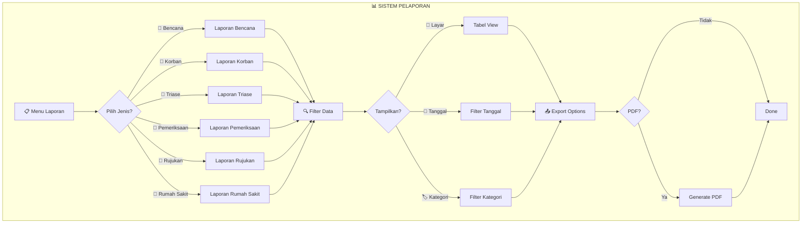
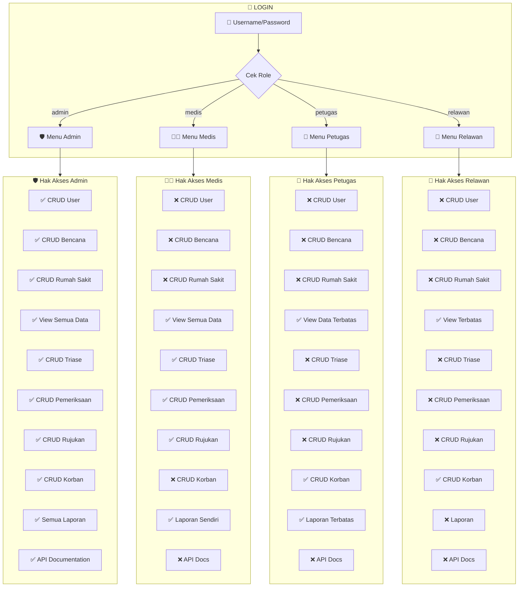
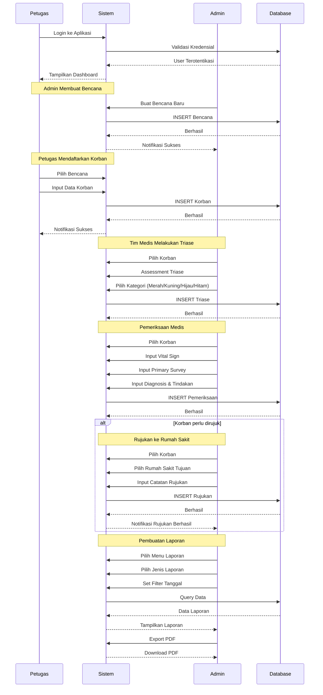
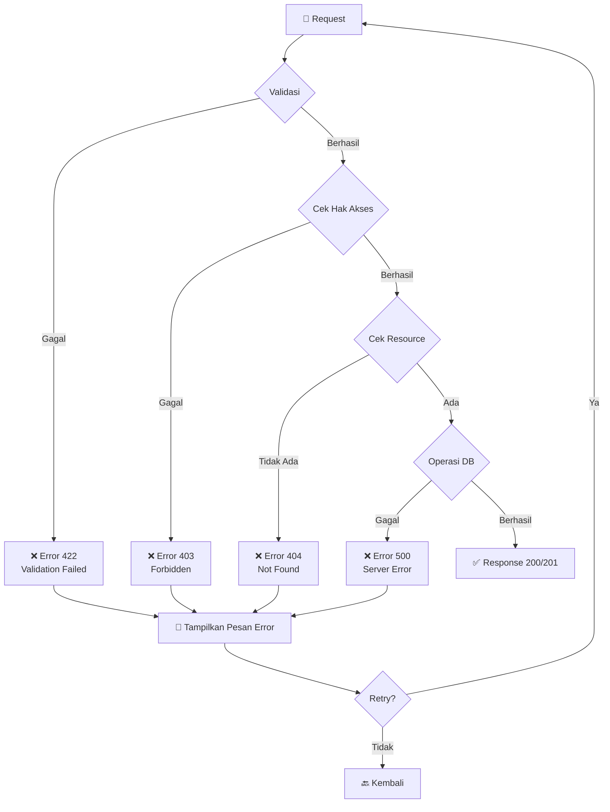

# Flowchart Aplikasi AppBencana

## 1. Diagram Alur Utama (Main Flow)



## 2. Alur CRUD Standar



## 3. Alur Bisnis Utama (Business Flow)



## 4. Alur API Mobile Application

```mermaid
flowchart TB
    subgraph API_AUTH["🔐 API Authentication"]
        API1[📱 Mobile App] --> API2{Login?}
        API2 -->|Ya| API3[POST /api/login]
        API3 --> API4[🔑 Token Sanctum]
        API2 -->|Logout| API5[POST /api/logout]
        API5 --> API6[🗑️ Hapus Token]
    end

    subgraph API_BENCANA["🌊 API Bencana"]
        API7[GET /api/bencana] --> API8[📋 List Semua Bencana]
        API7 --> API9[POST /api/bencana] --> API10[➕ Buat Bencana]
        API7 --> API11[GET /api/bencana/{id}] --> API12[👁️ Detail]
        API7 --> API12 --> API13[PUT /api/bencana/{id}] --> API14[✏️ Update]
        API7 --> API12 --> API15[DELETE /api/bencana/{id}] --> API16[🗑️ Hapus]
    end

    subgraph API_KORBAN["👥 API Korban"]
        API20[GET /api/korban] --> API21[📋 List]
        API20 --> API22[GET /api/korban/by-user] --> API23[👤 By User Login]
        API20 --> API24[POST /api/korban] --> API25[➕ Tambah]
        API20 --> API26[GET /api/korban/{id}] --> API27[👁️ Detail]
        API20 --> API26 --> API28[PUT /api/korban/{id}] --> API29[✏️ Update]
        API20 --> API26 --> API30[DELETE /api/korban/{id}] --> API31[🗑️ Hapus]
    end

    subgraph API_TRIASE["🏥 API Triase"]
        API40[GET /api/triase] --> API41[📋 List]
        API40 --> API42[GET /api/triase/by-user] --> API43[👤 By User]
        API40 --> API44[POST /api/triase] --> API45[➕ Assessment]
        API40 --> API46[GET /api/triase/{id}] --> API47[👁️ Detail]
        API40 --> API46 --> API48[PUT /api/triase/{id}] --> API49[✏️ Update]
        API40 --> API46 --> API50[DELETE /api/triase/{id}] --> API51[🗑️ Hapus]
    end

    subgraph API_PEMERIKSAAN["💉 API Pemeriksaan"]
        API60[GET /api/pemeriksaan] --> API61[📋 List]
        API60 --> API62[GET /api/pemeriksaan/by-user] --> API63[👤 By User]
        API60 --> API64[POST /api/pemeriksaan] --> API65[➕ Pemeriksaan Baru]
        API60 --> API66[GET /api/pemeriksaan/{id}] --> API67[👁️ Detail]
        API60 --> API66 --> API68[PUT /api/pemeriksaan/{id}] --> API69[✏️ Update]
        API60 --> API66 --> API70[DELETE /api/pemeriksaan/{id}] --> API71[🗑️ Hapus]
    end

    subgraph API_RUJUKAN["🔄 API Rujukan"]
        API80[GET /api/rujukan] --> API81[📋 List]
        API80 --> API82[GET /api/rujukan/by-user] --> API83[👤 By User]
        API80 --> API84[POST /api/rujukan] --> API85[➕ Rujuk]
        API80 --> API86[GET /api/rujukan/{id}] --> API87[👁️ Detail]
        API80 --> API86 --> API88[PUT /api/rujukan/{id}] --> API89[✏️ Update]
        API80 --> API86 --> API90[DELETE /api/rujukan/{id}] --> API91[🗑️ Hapus]
    end

    subgraph API_RS["🏨 API Rumah Sakit"]
        API100[GET /api/rumah-sakit] --> API101[📋 List RS]
        API100 --> API102[POST /api/rumah-sakit] --> API103[➕ Tambah RS]
        API100 --> API104[GET /api/rumah-sakit/{id}] --> API105[👁️ Detail]
        API100 --> API104 --> API106[PUT /api/rumah-sakit/{id}] --> API107[✏️ Update]
        API100 --> API104 --> API108[DELETE /api/rumah-sakit/{id}] --> API109[🗑️ Hapus]
        API100 --> API110[GET /api/rumah-sakit/nearby] --> API111[📍 Find Nearby]
    end
```

## 5. Diagram Relasi Entitas (Entity Relationship)



## 6. Flowchart Sistem Pelaporan (Reporting)



## 7. Alur Multi-User Role



## 8. Sequence Diagram: Alur Penanganan Korban



## 9. Alur Error Handling



## 10. Legenda

| Simbol | Keterangan |
|--------|------------|
| 🔐 | Autentikasi/Keamanan |
| 📋 | List/Index Data |
| ➕ | Create/Tambah Data |
| ✏️ | Edit/Update Data |
| 🗑️ | Delete/Hapus Data |
| 👁️ | Show/Detail Data |
| 💾 | Simpan ke Database |
| ❌ | Error/Gagal |
| ✅ | Berhasil |
| 🔄 | Refresh/Loop |
| 📤 | Export/Output |
| 📥 | Import/Input |

---

## Struktur Menu Admin

```
🏠 Dashboard
├── 📊 Statistik Keseluruhan
├── 📈 Recent Bencana
└── 🔗 Quick Actions

📋 Bencana
├── 📋 Daftar Bencana
├── ➕ Tambah Bencana
├── ✏️ Edit Bencana
├── 👁️ Detail Bencana
└── 🗑️ Hapus Bencana

👥 Korban
├── 📋 Daftar Korban
├── ➕ Tambah Korban
├── ✏️ Edit Korban
├── 👁️ Detail Korban
└── 🗑️ Hapus Korban

🏥 Triase
├── 📋 Daftar Triase
├── ➕ Assessment Triase
├── ✏️ Edit Triase
├── 👁️ Detail Triase
└── 🗑️ Hapus Triase

💉 Pemeriksaan
├── 📋 Daftar Pemeriksaan
├── ➕ Tambah Pemeriksaan
├── ✏️ Edit Pemeriksaan
├── 👁️ Detail Pemeriksaan
└── 🗑️ Hapus Pemeriksaan

🔄 Rujukan
├── 📋 Daftar Rujukan
├── ➕ Tambah Rujukan
├── ✏️ Edit Rujukan
├── 👁️ Detail Rujukan
└── 🗑️ Hapus Rujukan

🏨 Rumah Sakit
├── 📋 Daftar Rumah Sakit
├── ➕ Tambah Rumah Sakit
├── ✏️ Edit Rumah Sakit
├── 👁️ Detail Rumah Sakit
└── 🗑️ Hapus Rumah Sakit

👤 User Management
├── 📋 Daftar User
├── ➕ Tambah User
├── ✏️ Edit User
├── 👁️ Detail User
└── 🗑️ Hapus User

📄 Laporan
├── 📊 Laporan Bencana
├── 📊 Laporan Korban
├── 📊 Laporan Triase
├── 📊 Laporan Pemeriksaan
├── 📊 Laporan Rujukan
└── 📊 Laporan Rumah Sakit

📚 API Documentation
└── 📖 Panduan API
```

---

**Catatan:** Flowchart ini dibuat berdasarkan analisis kode aplikasi AppBencana yang merupakan sistem manajemen bencana berbasis web dan mobile API menggunakan Laravel framework.
